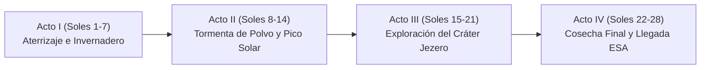

<div align="center">

# KHIPU MARS

### Simulador Interactivo 3D de Supervivencia, Ciencia de la NASA y Sabiduría Andina en el Planeta Rojo

[](https://www.typescriptlang.org/)
[](https://threejs.org/)
[](https://vitejs.dev/)
[](https://tailwindcss.com/)
[](https://gsap.com/)
[](https://www.i18next.com/)
[](https://api.nasa.gov/)
[](./LICENSE)

---

### Enlaces Oficiales del Proyecto

| Recurso | Enlace |
| :--- | :--- |
| **Deploy en Vivo (Producción)** | [**https://khipu-mars.vercel.app**](https://khipu-mars.vercel.app) *(Reemplazar con URL final de despliegue)* |
| **Video Demo Oficial** | [**Ver Video Demo de KHIPU MARS**](https://youtu.be/TU_ID_DE_VIDEO_DEMO) *(Reemplazar con enlace de YouTube / Vimeo)* |

</div>

---

## Video Demo

> **Espacio para el Video Demo:** Coloca aquí la vista previa o enlace al video demostrativo de **KHIPU MARS**.

<div align="center">
  <a href="https://youtu.be/TU_ID_DE_VIDEO_DEMO" target="_blank">
    
  </a>
</div>

---

## Descripción General del Proyecto

**KHIPU MARS** es un videojuego educativo y simulador interactivo 3D desarrollado para el **NASA Space Apps Challenge**, diseñado especialmente para niños y jóvenes de **7 a 12 años** (adaptable tanto a PC como a celulares y tablets táctiles).

El juego conecta dos mundos de ingeniería y gestión de supervivencia:
1. **La Ciencia Espacial Real de la NASA y la ESA:** Datos históricos reales de clima marciano (**Perseverance / MEDA**), tormentas solares (**NASA DONKI** y **Curiosity / RAD**), generación solar (**InSight**), soporte vital y reciclaje de agua (**ISS ECLSS**), producción de oxígeno (**MOXIE**) y agricultura espacial (**NASA OSDR VEG-05 y XROOTS**).
2. **La Sabiduría Ancestral Andina (*Khipu* y *Tambo*):** En lugar de abrumar a los niños con unidades científicas complejas, la colonia utiliza el **Khipu Mission Ledger** (un Khipu 3D interactivo de cuerdas y nudos luminosos) para registrar visualmente el equilibrio entre **Agua, Oxígeno, Energía, Cultivos y Radiación** dentro del hábitat **MARS-EF03 (Tambo Alfa)**.

---

## Storytelling e Intro Cinematográfica (4 Escenas en Primera Persona)

Al iniciar **KHIPU MARS**, el jugador vive una secuencia cinematográfica estilo película (`Letterbox 2.35:1`) con cámara 3D en tiempo real, visor de casco en primera persona y banda sonora espacial sintetizada con **Web Audio API**, disponible en **Español, Inglés y Quechua (Runasimi)**:

1. **Escena 1 — El Despegue del Futuro:**
   - *Visual:* Descenso en primera persona hacia el hábitat **MARS-EF03** brillando en el desierto rojo del Cráter Jezero bajo un cielo anaranjado.
   - *Narrativa:* *"Año 2038. Misión CHAPEA-3. Cuatro astronautas aterrizan en Marte con una meta: demostrar que los humanos pueden vivir 500 soles en el Planeta Rojo."*
2. **Escena 2 — El Incidente:**
   - *Visual:* Alerta roja en el módulo de carga; una tormenta de polvo repentina golpea los contenedores exteriores mientras los 4 astronautas corren físicamente hacia la esclusa del hábitat.
   - *Narrativa:* *"¡Alerta en el aterrizaje! Una tormenta repentina daña el módulo de carga y se pierden reservas vitales. La tripulación entra de emergencia al hábitat."*
3. **Escena 3 — La Cuenta Regresiva (La Conexión NASA–ESA):**
   - *Visual:* Mapa orbital interactivo mostrando una cápsula de suministro de la **ESA** descendiendo desde la órbita marciana mientras la antena **Chaski** mantiene el enlace.
   - *Narrativa:* *"La Tierra escucha, pero está muy lejos. Una cápsula de rescate de la ESA en órbita llegará con nuevos suministros en 28 soles."*
4. **Escena 4 — Tu Misión (Activación del Khipu):**
   - *Visual:* El **Khipu Mission Ledger** se ilumina frente a los 4 especialistas de la tripulación.
   - *Narrativa:* *"Cada decisión cuenta. Usa el Khipu para equilibrar energía, agua, cultivos y radiación. Tu reto: mantener viva la misión durante 28 soles."*

---

## Los 4 Roles Jugables y Toma de Decisiones

Antes de comenzar el Día 1, el jugador elige su especialidad dentro de la tripulación. Cada acción en el juego muestra claramente **Lo bueno (beneficio)**, **El costo (sacrificio de recursos)** y la **Ventaja de tu Rol**:

| Rol | Insignia 3D | Función en la Colonia | Ventaja Especial en la Simulación |
| :--- | :--- | :--- | :--- |
| **Comandante** | Naranja | Lidera la misión y coordina las decisiones en momentos de peligro. | Ahorra oxígeno y energía adicional al organizar a la tripulación durante emergencias. |
| **Ingeniero** | Amarillo | Repara máquinas, limpia paneles solares y sella el reciclador de agua. | Consume menos piezas de repuesto y recupera un **+35% de energía** al limpiar paneles o reparar tuberías. |
| **Médico** | Rojo / Verde | Cuida la salud física de los astronautas y vigila el blindaje contra radiación. | Reduce más rápido la radiación acumulada y mejora la recuperación del equipo en el refugio. |
| **Científico** | Azul | Investiga el Cráter Jezero con el Rover y cultiva plantas en el invernadero. | Las plantas del invernadero crecen un **+30% más rápido** y el Rover extrae más hielo de agua y minerales. |

---

## Estructura de Niveles: Los 4 Actos (28 Soles) y Eventos de Crisis

La campaña completa dura **28 Soles (días marcianos)** divididos en **4 Actos de 7 Soles cada uno**, calibrados con el registro histórico real de la tormenta solar de mayo–junio de 2024:



### Niveles / Actos de la Misión
- **Nivel 1 — Acto I (Soles 1 al 7): Desembarco, Tutorial e Invernadero Inicial**
  - Incluye el **Tutorial Interactivo en 4 pasos**.
  - Puesta en marcha del invernadero espacial, calibración de paneles solares y primeros remolinos de viento en Jezero (**Sol 4**).
- **Nivel 2 — Acto II (Soles 8 al 14): Tormenta de Polvo, Fuga de Agua y Supertormenta Solar**
  - **Sol 8 y Sol 12:** Ráfagas de viento de `25 m/s` y tormenta de polvo que cubre las celdas solares (**Evento A**).
  - **Sol 10:** Avería en la válvula del reciclador de agua que activa la baliza roja de emergencia (**Evento B**).
  - **Sol 13:** Impacto histórico de partículas solares (**Evento C**, basado en el pico real de `8,100 µGy/día` medido por *Curiosity/RAD* el 20 de mayo de 2024).
- **Nivel 3 — Acto III (Soles 15 al 21): Recuperación y Expediciones del Rover Perseverance**
  - **Sol 16:** Remolinos limpiadores (*Dust Devils*) que permiten recuperar energía si se orientan los paneles (**Evento D**).
  - **Sol 18 y Sol 20:** Mantenimiento crítico de soporte vital y expediciones del Rover hacia el delta del antiguo lago Jezero para extraer hielo de agua.
- **Nivel 4 — Acto IV (Soles 22 al 28): Cosecha Hidropónica y Encuentro con la Cápsula ESA**
  - **Sol 22 y Sol 24:** Última alerta solar y estabilización final del ecosistema cerrado del hábitat hasta alcanzar la victoria en el **Sol 28**.

---

## El Rol del Khipu 3D (`KhipuController.ts`)

El archivo `khipu-tracker.glb` se renderiza en tiempo real en el panel lateral derecho (o desplegable en móviles) y traduce el estado matemático de la base a un sistema visual comprensible para niños:
- **4 Cuerdas Principales:** *Comida/Cultivos*, *Energía*, *Alerta de Radiación* y *Agua/Suministros*.
- **20 Nudos de Recursos (`Knot_[Recurso]_L1` a `L5`):** Cada nudo representa un **20%**. Si un recurso está al `60%`, los nudos `L1..L3` brillan a escala completa `(1, 1, 1)` y los nudos `L4..L5` se atenúan a `(0.35, 0.35, 0.35)`.
- **4 Nudos de Nivel/Acto (`Act_Knot_01` a `04`):** Se iluminan en el cordón maestro superior conforme el jugador avanza por los 4 Actos de la misión.

---

## Motor Gráfico 3D, Colisiones y Simulación Física de Tareas

A diferencia de un juego de botones estáticos, **KHIPU MARS** es una simulación viva en 3D:

1. **Los 7 Modelos 3D (`.glb`) en `/public/models/`:**
   - `jezero-terrain.glb`: Terreno del Cráter Jezero con recepción de sombras y muestreo de altura por Raycast.
   - `tambo-alfa.glb`: Hábitat central **MARS-EF03**, domo agrícola e invernadero con antena `Chaski_Antenna_Dish` rotando en bucle.
   - `solar-panels-array.glb`: Dos matrices solares (Este y Oeste) cuyas celdas (`Mat_Celda_Solar`) cambian dinámicamente de azul limpio a marrón rojizo cuando se cubren de polvo marciano.
   - `mars-rover.glb`: Rover explorador con 6 ruedas articuladas, mástil de cámara y brazo robótico para extraer hielo y minerales.
   - `external-equipment.glb`: Reciclador de agua con baliza luminosa (`Recycler_Status_Beacon`) y estación meteorológica MEDA con anemómetro giratorio.
   - `astronaut-character.glb`: Astronauta principal (controlado por el jugador) + **3 Especialistas NPC autónomos** (*Ingeniero*, *Científica* y *Médico*).
   - `khipu-tracker.glb`: Khipu 3D interactivo con medallón solar Inti.
2. **Colisiones Sólidas y Altura Real de Terreno:**
   - Muestreo vertical con `THREE.Raycaster` (`sampleTerrainHeight`) para que ningún personaje, edificio ni vehículo flote o se hunda en el suelo.
   - Resolución de colisiones cilíndricas 2D (`resolvePositionWithCollisions`) con deslizamiento tangencial para que ningún personaje traspase estructuras, paneles, el Rover ni a otros astronautas.
3. **Ejecución Física de Misiones y Trabajo en Equipo con NPCs:**
   - Al elegir cualquier tarea (*Regar Plantas*, *Cosechar*, *Limpiar Paneles*, *Reparar Reciclador*, *Enviar Rover*), el astronauta (o el Rover) **camina físicamente hasta la estación acompañado por el especialista NPC correspondiente**.
   - Al llegar, ejecuta la animación de trabajo (`SWEEPING_PANELS`, `REPAIRING_PIPES`, `WATERING_CROPS`, `SCANNING_ROCKS`) con partículas 3D y barra de progreso en vivo antes de actualizar los recursos.
   - Los 3 NPCs patrullan sus estaciones de especialidad, conversan entre sí cuando se cruzan y saludan al jugador con consejos útiles cuando te acercas a ellos.
4. **Adaptación Inteligente PC vs. Móvil:**
   - En dispositivos móviles/tablets táctiles se habilita el **D-Pad / Joystick táctil** y gestos multi-touch (`1 dedo: rotar`, `2 dedos: zoom/paneo`).
   - En PC de escritorio el joystick táctil **se oculta automáticamente**, priorizando el clic directo sobre el terreno (*Tap-to-Move*) y las teclas `WASD`.

---

## Arquitectura del Proyecto

```text
khipu-mars/
├── public/
│   └── models/                  # Los 7 modelos 3D (.glb) del Cráter Jezero, Hábitat, Rover, Astronautas y Khipu
├── src/
│   ├── core/
│   │   ├── constants.ts         # Parámetros científicos NASA, nodos Blender y ley de Beer-Lambert
│   │   └── types.ts             # Tipos globales de telemetría, recursos, roles y eventos
│   ├── locales/
│   │   ├── i18n.ts              # Configuración trilingüe i18next
│   │   ├── es.json              # Textos en Español (adaptados para niños de 7 a 12 años)
│   │   ├── en.json              # Textos en Inglés
│   │   └── qu.json              # Textos en Quechua (Runasimi)
│   ├── services/
│   │   └── NasaDataService.ts   # Conexión en vivo con NASA API (DONKI) + Dataset histórico offline de 28 Soles
│   ├── simulation/
│   │   ├── ResourceEngine.ts    # Motor matemático R(t+1) = R(t) + P(t) - C(t) - L(t)
│   │   └── EventSystem.ts       # Eventos A, B, C, D y menús contextuales con bonos por Rol
│   ├── world/
│   │   ├── AssetLoader.ts       # Carga progresiva de modelos GLB y configuración de sombras
│   │   ├── AnimationController.ts # Animaciones articulares de caminata, barrido, reparación, riego y Rover
│   │   ├── InputManager.ts      # Raycasting unificado (PointerEvents), hitboxes y atajos de teclado
│   │   ├── TouchNavigation.ts   # Colisiones, altura de terreno, IA de NPCs y tareas físicas en tiempo real
│   │   └── SceneManager.ts      # Escena Three.js, luces, niebla marciana y cámaras cinematográficas GSAP
│   ├── ui/
│   │   ├── icons.ts             # Biblioteca de íconos vectoriales SVG e ilustraciones de los 4 roles
│   │   ├── KhipuController.ts   # Visor 3D interactivo y sincronización de los 20 nudos del Khipu
│   │   └── index.ts             # Intro de 4 escenas, Tutorial interactivo, HUD espacial y audio Web Audio API
│   ├── main.ts                  # Punto de entrada de la aplicación
│   └── style.css                # Estilos Tailwind CSS y reglas mobile-first
├── index.html
├── package.json
├── tsconfig.json
├── vite.config.ts
└── LICENSE                      # Licencia MIT
```

---

## Instalación y Ejecución Local

### 1. Clonar el repositorio e instalar dependencias
```bash
git clone https://github.com/TU_USUARIO/khipu-mars.git
cd khipu-mars
npm install
```

### 2. Configurar la API Key de la NASA (Opcional)
El juego funciona **100% offline** gracias a su dataset histórico pre-calibrado de 28 Soles y utiliza `DEMO_KEY` por defecto. Si deseas conectar tu propia clave gratuita de [api.nasa.gov](https://api.nasa.gov/), crea un archivo `.env` en la raíz del proyecto:

```env
VITE_NASA_API_KEY=TU_API_KEY_DE_LA_NASA
```

### 3. Iniciar el servidor de desarrollo
```bash
npm run dev
```

### 4. Compilar para producción (Vercel / Netlify / GitHub Pages)
```bash
npm run build
npm run preview
```

---

## Licencia

Este proyecto está distribuido bajo la **Licencia MIT**. Consulta el archivo [LICENSE](./LICENSE) para ver el texto legal completo.
